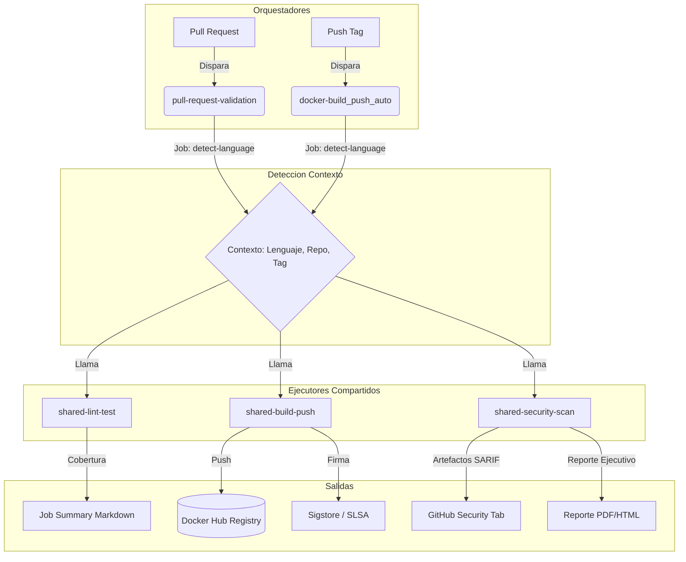

# 🏗️ Arquitectura y Diseño del Sistema CI/CD

El diseño arquitectónico de este repositorio se basa fuertemente en el patrón de **Flujos de Trabajo Reutilizables (Reusable Workflows)** de GitHub Actions. Este enfoque separa las responsabilidades de orquestación y ejecución, logrando un código *DRY* (Don't Repeat Yourself) y facilitando el mantenimiento a escala corporativa.

## 1. Diseño Arquitectónico (Patrón Orquestador / Trabajador)

El sistema se divide lógicamente en dos capas:

### Capa de Orquestación (Disparadores)
Esta capa es responsable de escuchar los eventos del repositorio (Push, Pull Request, Release) y de calcular el contexto inicial. Los archivos pertenecientes a esta capa son:
- `docker-build_push_auto.yml` (Para releases y tags)
- `pull-request-validation.yml` (Para CI sobre PRs)

**Responsabilidades:**
1. Detectar el lenguaje del proyecto (Node.js, Go, Java, Python).
2. Sanitizar y estandarizar el nombre del repositorio (`REPO_LC`).
3. Determinar el tag de la imagen Docker.
4. Pasar este contexto (`inputs` y `secrets`) a los flujos de trabajo reutilizables.

### Capa de Ejecución (Flujos Reutilizables)
Estos flujos, prefijados con `shared-*.yml`, contienen la lógica técnica "pesada". Son agnósticos al evento que los disparó.
- `shared-lint-test.yml`: Calidad de código y cobertura de pruebas.
- `shared-build-push.yml`: Cacheo GHA, compilación Buildx, firma Sigstore/Cosign y generación de SBOM.
- `shared-security-scan.yml`: Escaneos de vulnerabilidades (Trivy, Checkov) y consolidación del PDF.

## 2. Flujo de Datos y Diagrama de Componentes



## 3. Estrategia de Caché Multi-Arquitectura

El bloque de compilación Docker en `shared-build-push.yml` implementa el caché nativo de GitHub Actions (`type=gha`), el cual ofrece transferencias locales ultra-rápidas en lugar del tradicional caché de registro en red (`type=registry`). 

```yaml
# Fragmento del Caché en Buildx
cache-from: type=gha
cache-to: type=gha,mode=max
```
Esto reduce los tiempos de compilación de 10 minutos a menos de 45 segundos para reconstrucciones.

## 4. Estrategia de Firmado y Provenance (SLSA 3)

Al finalizar la construcción, el motor utiliza `cosign` en modo *Keyless* (OIDC) atado a la identidad de GitHub Actions.
1. Se construye la imagen y se extrae el digest (SHA256).
2. Se genera el SBOM en formato SPDX de forma automática durante el build.
3. Se publica en Docker Hub.
4. `cosign sign` inyecta la firma en el registro remoto, vinculando criptográficamente el commit exacto con la imagen de Docker, previniendo alteraciones y *supply-chain attacks*.
