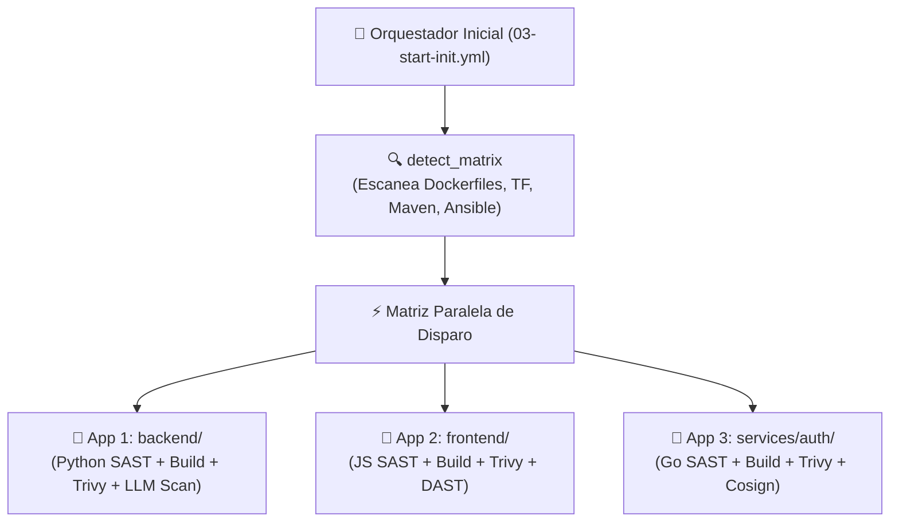
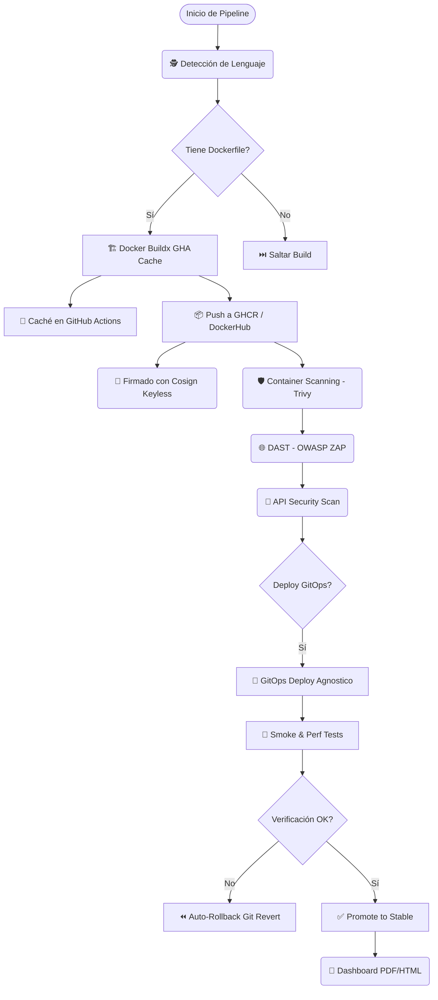

# 🏗️ Arquitectura y Diseño del Sistema CI/CD (GitHub Actions)

Nuestras plantillas implementan un ciclo **DevSecOps 360°** modular y escalable para **GitHub Actions**, soportando tanto proyectos monolíticos como **Monorepos políglotas** complejos con compilación paralela y GitOps declarativo.

---

## 1. Patrón Orquestador y Matriz Dinámica (`03-start-init.yml`)

En lugar de crear archivos `.github/workflows/` duplicados en cada repositorio, los proyectos clientes importan un único punto de entrada:

### Ventajas del diseño:
- **Aislamiento Total:** Si un microservicio falla sus pruebas unitarias, los demás continúan su ciclo de compilación y despliegue sin bloquearse.
- **Ejecución Paralela:** Todos los microservicios se compilan y escanean al mismo tiempo en runners independientes.
- **Especialización por Lenguaje:** El runner de Python ejecuta `pytest`/`pip-audit` y el runner de Node.js ejecuta `npm test`/`npm audit`.

---

## 2. Flujo Completo DevSecOps 360° en Contenedores

---

## 3. Orquestadores y Puntos de Entrada

| Orquestador | Arquitectura | Motor Docker | Caso de Uso Ideal |
| :--- | :--- | :--- | :--- |
| **`03-start-init.yml`** | Enrutador Dinámico | N/A | **Cualquier proyecto**. Punto de entrada recomendado para delegar el descubrimiento a la lógica del pipeline. |
| **`03-start-docker-matrix-child.yml`** | Reusable Workflow | Docker BuildKit (Buildx) | Pipeline secundario de microservicios contenedorizados. |
| **`03-start-iac.yml`** | Especialidad Terraform | N/A | Repositorios de infraestructura gestionados con Terraform y FinOps (Infracost). |
| **`infrastructure-ansible.yml`** | Especialidad Ansible | N/A | Automatización de configuración y playbooks de Ansible. |
| **`libraries-maven-lib.yml`** | Especialidad Java | N/A | Librerías compartidas Java/Maven con escaneo y publicación a GitHub Packages. |
| **`k8s-gitops.yml`** | Especialidad GitOps | N/A | Validación de manifiestos YAML y esquemas K8s. |
