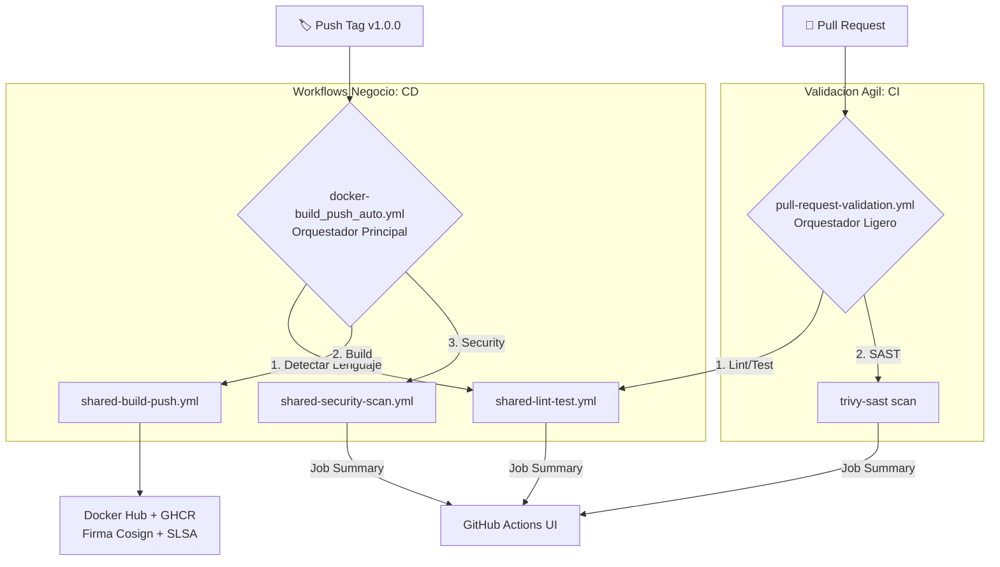
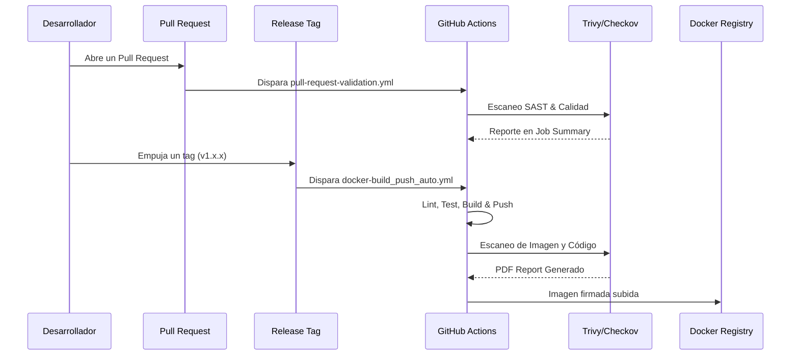
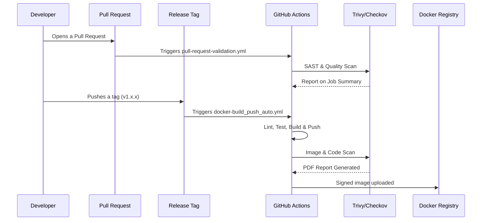
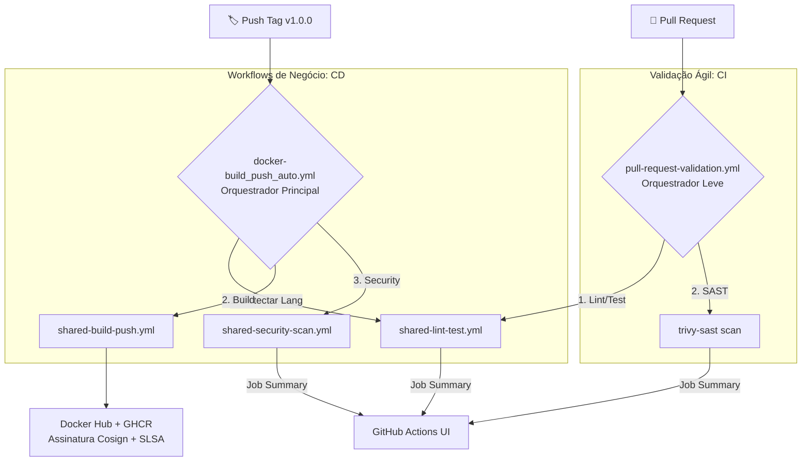
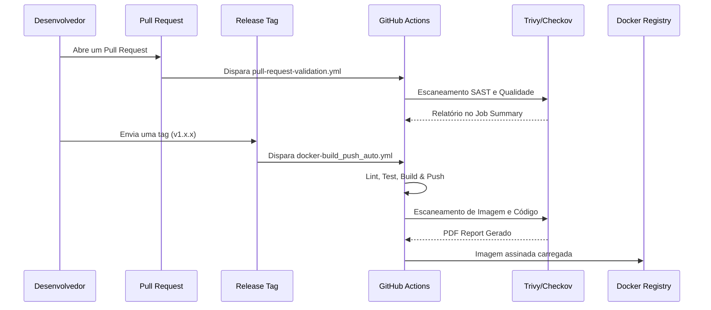

<!-- START_BADGES -->
<div align="center">
  
  
  
</div>
<!-- END_BADGES -->

#  GitHub Template - CI/CD DevSecOps Pipeline

<div align="center">
  <p>
    <a href="#español">🇨🇴 Español</a> | 
    <a href="#english">🇺🇸 English</a> | 
    <a href="#português">🇧🇷 Português</a>
  </p>
</div>

---

<h2 id="español">🇨🇴 Español</h2>

Plantilla de repositorio **Estado del Arte** para GitHub con pipelines CI/CD modulares, ultrarrápidos y seguros. Diseñado para ofrecer una experiencia de desarrollador (DX) superior, compilaciones Docker multi-arquitectura optimizadas, Integración Continua en ramas efímeras y estándares completos de seguridad automatizada.

### 🌟 Características Principales

- **Arquitectura Modular (`uses:`):** Flujos divididos en bloques reutilizables (Lint/Test, Build/Push, y Security).
- **Continuous Integration Ágil:** Escanea la calidad del código y SAST en segundos al revisar PRs.
- **Linter de Dockerfile (Hadolint):** Validación recursiva y fortificación de Dockerfiles (`hadolint`) para erradicar malas prácticas e inseguridades de inmediato.
- **Auditoría de Dependencias Nativas (SCA):** Análisis dinámico de seguridad del lenguaje detectado (`npm audit`, `pip-audit`, `govulncheck`) con políticas tolerantes (Soft Fail) para un desarrollo sin interrupciones.
- **Detección de Secretos:** Integración nativa de **Gitleaks** para prevenir fugas accidentales de tokens y credenciales.
- **Dynamic Application Security Testing (DAST):** Escaneo en tiempo de ejecución con **OWASP ZAP** (despliegue efímero automático).
- **Caché Avanzada (GHA):** Compilación Docker usando el caché nativo de GitHub Actions.
- **CycloneDX SBOM & Firma Cosign (SLSA 3):** Generación de SBOM firmado criptográficamente con Cosign, atestiguado en el registro y exportable.
- **Dashboard de Pipeline en Reporte:** Dashboard ejecutivo e interactivo que consolida la compilación, pruebas y seguridad directo en el PDF/HTML consolidado.
- **Auto-cancelación Redundante:** Aborta despliegues paralelos solapados, ahorrando minutos de cómputo.
- **DX Nativo (Job Summaries):** Resultados inyectados en Markdown nativo sin requerir descargas.
- **Dependabot Activo:** Actualización semanal automática de actions y contenedores.

### 🏗️ Arquitectura Técnica de Alto Nivel



### 🔀 Diagrama de Secuencia



### 🛠️ Stack Tecnológico

| Capa / Layer | Tecnología / Technology | Descripción / Description |
| --- | --- | --- |
| **CI/CD Platform** | GitHub Actions | Plataforma principal de automatización. |
| **Containerization** | Docker / Buildx | Compilación y despliegue multi-arquitectura. |
| **Security Scanning** | Trivy, Checkov, Hadolint, OWASP ZAP & SCA Nativo | Escaneo SAST/SCA, contenedores (IaC/Hadolint), DAST dinámico efímero y auditorías nativas del lenguaje (`npm audit`, `pip-audit`, `govulncheck`). |
| **Secret Scanning** | Gitleaks | Análisis de prevención de fugas de credenciales en el código. |
| **Attestation & SBOM** | Sigstore / Cosign & CycloneDX | Firma criptográfica de imágenes y atestación de SBOM CycloneDX (SLSA 3). |

### ⚙️ Requisitos Previos

- Una cuenta de **Docker Hub** o GitHub Container Registry.
- Un repositorio en GitHub para instanciar esta plantilla.
- Archivos estándar de lenguaje detectables (`go.mod`, `package.json`, `pom.xml`, etc.).

### 🛠️ Instrucciones de Despliegue

1. Haz clic en el botón **"Use this template"** en GitHub.
2. Clona tu nuevo repositorio.
3. Ve a **Settings → Secrets and variables → Actions** en GitHub y configura:
   - `DOCKERHUB_USERNAME` (Tu usuario)
   - `DOCKERHUB_TOKEN` (Token de seguridad)
   - `DOCKERHUB_REPO` (El nombre de tu contenedor final)

### 🔄 Reuso del Workflow en Repositorios de Desarrollo

Si tienes repositorios de desarrollo (microservicios) y deseas reusar de forma centralizada este workflow modular sin duplicar el pipeline, puedes invocarlo directamente como un workflow reutilizable (`workflow_call`).

Crea un archivo `.github/workflows/deploy.yml` en tu repositorio de desarrollo con la siguiente estructura:

```yaml
name: Continuous Delivery

on:
  push:
    tags:
      - 'v*.*.*'
  workflow_dispatch:

jobs:
  devsecops-pipeline:
    uses: grs89/github-template/.github/workflows/docker-publish.yml@v2
    with:
      CONTEXT_DIR: '.'              # Opcional, directorio del código
      DOCKERFILE_PATH: './Dockerfile' # Opcional, ruta del Dockerfile
    secrets:
      DOCKERHUB_USERNAME: ${{ secrets.DOCKERHUB_USERNAME }}
      DOCKERHUB_TOKEN: ${{ secrets.DOCKERHUB_TOKEN }}
      DOCKERHUB_REPO: ${{ secrets.DOCKERHUB_REPO }}
```

> [!IMPORTANT]
> Recuerda configurar los secretos `DOCKERHUB_USERNAME`, `DOCKERHUB_TOKEN` y `DOCKERHUB_REPO` en la pestaña **Settings > Secrets and variables > Actions** de tu repositorio de desarrollo para posibilitar el login, compilación y firma.

### 🚀 Inicio Rápido (Quick Start)

Para probar la Integración Continua (CI), simplemente abre un Pull Request:
```bash
git checkout -b feature/test-ci
# Realiza un cambio
git add . && git commit -m "feat: prueba ci"
git push origin feature/test-ci
```

Para publicar a producción (CD), lanza un tag:
```bash
git tag v1.0.0
git push origin v1.0.0
```

### 🧪 Ejecución de Pruebas

Los tests se ejecutan automáticamente en el flujo `shared-lint-test.yml`. Si el lenguaje es detectado (ej. Go, Node.js), el sistema inyectará la cobertura en el *Job Summary* usando:
- **Go**: `go test ./... -coverprofile=coverage.out`
- **Node**: `npm test -- --coverage`

### 📄 Licencia

Licencia **MIT**. Consulta el archivo `LICENSE` para detalles.

---

<h2 id="english">🇺🇸 English</h2>

**State-of-the-Art** GitHub repository template with modular, ultra-fast, and secure CI/CD pipelines. Designed to deliver superior Developer Experience (DX), optimized multi-architecture Docker builds, continuous integration on ephemeral branches, and comprehensive automated security standards.

### 🌟 Main Features

- **Modular Architecture (`uses:`):** Flows split into reusable blocks (Lint/Test, Build/Push, and Security).
- **Agile Continuous Integration:** Scans code quality and SAST in seconds upon PR review.
- **Dockerfile Linter (Hadolint):** Recursive validation and hardening of Dockerfiles (`hadolint`) to eliminate bad practices right from the source.
- **Native Dependency Audit (SCA):** Dynamic security analysis of the detected language (`npm audit`, `pip-audit`, `govulncheck`) with tolerant (Soft Fail) policies to avoid blocking deployments.
- **Secret Scanning:** Native **Gitleaks** integration to prevent accidental credentials and token leaks.
- **Dynamic Application Security Testing (DAST):** Runtime dynamic scan with **OWASP ZAP** (automatic ephemeral deployment).
- **Advanced Caching (GHA):** Docker build using ultra-fast native GitHub Actions caching.
- **CycloneDX SBOM & Cosign Signature (SLSA 3):** Cryptographically signed CycloneDX SBOM attested to the registry and exportable.
- **Pipeline Dashboard in PDF Report:** Interactive executive dashboard consolidating pipeline compile, test, and security states directly in the final PDF/HTML.
- **Redundant Auto-Cancellation:** Aborts overlapping parallel deployments, saving compute minutes.
- **Native DX (Job Summaries):** Results injected into native Markdown without requiring downloads.
- **Active Dependabot:** Automatic weekly updates for actions and base containers.

### 🏗️ High-Level Technical Architecture


### 🔀 Sequence Diagram



### 🛠️ Tech Stack

| Capa / Layer | Tecnología / Technology | Descripción / Description |
| --- | --- | --- |
| **CI/CD Platform** | GitHub Actions | Main automation platform. |
| **Containerization** | Docker / Buildx | Multi-architecture build and deployment. |
| **Security Scanning** | Trivy, Checkov, Hadolint, OWASP ZAP & Native SCA | SAST/SCA, containers (IaC/Hadolint), dynamic ephemeral DAST, and native language audits (`npm audit`, `pip-audit`, `govulncheck`). |
| **Secret Scanning** | Gitleaks | Code credentials and token leak prevention analysis. |
| **Attestation & SBOM** | Sigstore / Cosign & CycloneDX | Cryptographic container signing and CycloneDX SBOM attestation (SLSA 3). |

### ⚙️ Prerequisites

- A **Docker Hub** or GitHub Container Registry account.
- A GitHub repository to instantiate this template.
- Detectable standard language files (`go.mod`, `package.json`, `pom.xml`, etc.).

### 🛠️ Deployment Instructions

1. Click the **"Use this template"** button on GitHub.
2. Clone your new repository.
3. Go to **Settings → Secrets and variables → Actions** in GitHub and configure:
   - `DOCKERHUB_USERNAME` (Your user)
   - `DOCKERHUB_TOKEN` (Security token)
   - `DOCKERHUB_REPO` (Your final container name)

### 🔄 Workflow Reuse in Development Repositories

If you have development repositories (microservices) and want to centrally reuse this modular workflow without duplicating the pipeline code, you can invoke it directly as a reusable workflow (`workflow_call`).

Create a file `.github/workflows/deploy.yml` in your development repository with the following structure:

```yaml
name: Continuous Delivery

on:
  push:
    tags:
      - 'v*.*.*'
  workflow_dispatch:

jobs:
  devsecops-pipeline:
    uses: grs89/github-template/.github/workflows/docker-publish.yml@v2
    with:
      CONTEXT_DIR: '.'              # Optional, source code directory
      DOCKERFILE_PATH: './Dockerfile' # Optional, relative Dockerfile path
    secrets:
      DOCKERHUB_USERNAME: ${{ secrets.DOCKERHUB_USERNAME }}
      DOCKERHUB_TOKEN: ${{ secrets.DOCKERHUB_TOKEN }}
      DOCKERHUB_REPO: ${{ secrets.DOCKERHUB_REPO }}
```

> [!IMPORTANT]
> Remember to configure the secrets `DOCKERHUB_USERNAME`, `DOCKERHUB_TOKEN`, and `DOCKERHUB_REPO` under **Settings > Secrets and variables > Actions** of your development repository to enable login, compilation, and signing.

### 🚀 Quick Start

To test Continuous Integration (CI), simply open a Pull Request:
```bash
git checkout -b feature/test-ci
# Make a change
git add . && git commit -m "feat: test ci"
git push origin feature/test-ci
```

To publish to production (CD), push a tag:
```bash
git tag v1.0.0
git push origin v1.0.0
```

### 🧪 Test Execution

Tests are executed automatically in the `shared-lint-test.yml` flow. If the language is detected (e.g. Go, Node.js), the system will inject the coverage into the *Job Summary* using:
- **Go**: `go test ./... -coverprofile=coverage.out`
- **Node**: `npm test -- --coverage`

### 📄 License

**MIT** License. See the `LICENSE` file for details.

---

<h2 id="português">🇧🇷 Português</h2>

Modelo de repositório **Estado da Arte** para o GitHub com pipelines CI/CD modulares, ultra-rápidos e seguros. Projetado para oferecer uma Experiência do Desenvolvedor (DX) superior, builds Docker multi-arquitetura otimizados, Integração Contínua em filiais efêmeras e padrões completos de segurança automatizada.

### 🌟 Principais Funcionalidades

- **Arquitetura Modular (`uses:`):** Fluxos divididos em blocos reutilizáveis (Lint/Test, Build/Push e Security).
- **Integração Contínua Ágil:** Verifica a qualidade do código e o SAST em segundos após a revisão de PR.
- **Linter de Dockerfile (Hadolint):** Validação recursiva e endurecimento de Dockerfiles (`hadolint`) para erradicar más práticas imediatamente.
- **Auditoria de Dependências Nativas (SCA):** Análise dinâmica de segurança da linguagem detectada (`npm audit`, `pip-audit`, `govulncheck`) com políticas tolerantes (Soft Fail) para não travar implantações.
- **Detecção de Segredos:** Integração nativa do **Gitleaks** para prevenir vazamentos acidentais de tokens e credenciais.
- **Dynamic Application Security Testing (DAST):** Varredura em tempo de execução com **OWASP ZAP** (implantação efêmera automática).
- **Cache Avançado (GHA):** Compilação Docker usando o cache nativo super rápido do GitHub Actions.
- **CycloneDX SBOM & Assinatura Cosign (SLSA 3):** Geração de SBOM assinado criptograficamente com Cosign, atestado no registro e exportável.
- **Dashboard de Pipeline no Relatório:** Painel executivo e interativo que consolida a compilação, testes e segurança diretamente no PDF/HTML final.
- **Autocancelamento Redundante:** Aborta implantações paralelas sobrepostas, economizando minutos de computação.
- **DX Nativo (Job Summaries):** Resultados injetados em Markdown nativo sem exigir downloads.
- **Dependabot Ativo:** Atualizações semanais automáticas para ações e contêineres base.

### 🏗️ Arquitetura Técnica de Alto Nível



### 🔀 Diagrama de Sequência



### 🛠️ Stack Tecnológica

| Capa / Layer | Tecnología / Technology | Descripción / Description |
| --- | --- | --- |
| **CI/CD Platform** | GitHub Actions | Principal plataforma de automação. |
| **Containerization** | Docker / Buildx | Build e implantação multi-arquitetura. |
| **Security Scanning** | Trivy, Checkov, Hadolint, OWASP ZAP & SCA Nativo | Varredura SAST/SCA, contêineres (IaC/Hadolint), DAST dinâmico efêmero e auditorias nativas do idioma (`npm audit`, `pip-audit`, `govulncheck`). |
| **Secret Scanning** | Gitleaks | Análise de prevenção de vazamentos de credenciais no código. |
| **Attestation & SBOM** | Sigstore / Cosign & CycloneDX | Assinatura criptográfica de imagens e atestação de SBOM CycloneDX (SLSA 3). |

### ⚙️ Pré-requisitos

- Uma conta no **Docker Hub** ou GitHub Container Registry.
- Um repositório no GitHub para instanciar este modelo.
- Arquivos de idioma padrão detectáveis (`go.mod`, `package.json`, `pom.xml`, etc.).

### 🛠️ Instruções de Implantação

1. Clique no botão **"Use this template"** no GitHub.
2. Clone o seu novo repositório.
3. Vá para **Settings → Secrets and variables → Actions** no GitHub e configure:
   - `DOCKERHUB_USERNAME` (Seu usuário)
   - `DOCKERHUB_TOKEN` (Token de segurança)
   - `DOCKERHUB_REPO` (O nome do seu contêiner final)

### 🔄 Reuso do Workflow em Repositórios de Desenvolvimento

Se você possui repositórios de desenvolvimento (microsserviços) e deseja reutilizar este fluxo modular de forma centralizada sem duplicar o pipeline, pode invocá-lo diretamente como um fluxo de trabalho reutilizável (`workflow_call`).

Crie um arquivo `.github/workflows/deploy.yml` em seu repositório de desenvolvimento com a seguinte estrutura:

```yaml
name: Continuous Delivery

on:
  push:
    tags:
      - 'v*.*.*'
  workflow_dispatch:

jobs:
  devsecops-pipeline:
    uses: grs89/github-template/.github/workflows/docker-publish.yml@v2
    with:
      CONTEXT_DIR: '.'              # Opcional, diretório do código
      DOCKERFILE_PATH: './Dockerfile' # Opcional, caminho do Dockerfile
    secrets:
      DOCKERHUB_USERNAME: ${{ secrets.DOCKERHUB_USERNAME }}
      DOCKERHUB_TOKEN: ${{ secrets.DOCKERHUB_TOKEN }}
      DOCKERHUB_REPO: ${{ secrets.DOCKERHUB_REPO }}
```

> [!IMPORTANT]
> Lembre-se de configurar os segredos `DOCKERHUB_USERNAME`, `DOCKERHUB_TOKEN` e `DOCKERHUB_REPO` na aba **Settings > Secrets and variables > Actions** do seu repositório de desenvolvimento para permitir login, compilação e assinatura.

### 🚀 Início Rápido (Quick Start)

Para testar a Integração Contínua (CI), basta abrir um Pull Request:
```bash
git checkout -b feature/test-ci
# Faça uma alteração
git add . && git commit -m "feat: test ci"
git push origin feature/test-ci
```

Para publicar em produção (CD), envie uma tag:
```bash
git tag v1.0.0
git push origin v1.0.0
```

### 🧪 Execução de Testes

Os testes são executados automaticamente no fluxo `shared-lint-test.yml`. Se a linguagem for detectada (por exemplo, Go, Node.js), o sistema injetará a cobertura no *Job Summary* usando:
- **Go**: `go test ./... -coverprofile=coverage.out`
- **Node**: `npm test -- --coverage`

### 📄 Licença

Licença **MIT**. Veja o arquivo `LICENSE` para mais detalhes.

---
