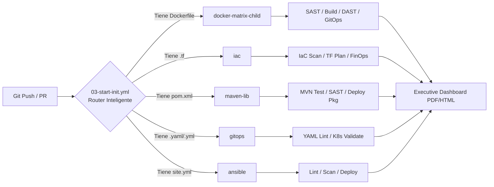

<!-- START_BADGES -->
<p align="center">
  
  
  
  
  
  
  
  
</p>
<!-- END_BADGES -->

#  GitHub DevSecOps Templates

<div align="center">
  <p>
    <a href="#español">🇨🇴 Español</a> | 
    <a href="#english">🇺🇸 English</a> | 
    <a href="#portugues">🇧🇷 Português</a>
  </p>
</div>

---

<h2 id="español">🇨🇴 Español</h2>

### Descripción del proyecto
**GitHub DevSecOps Templates** es la librería central de flujos de trabajo reutilizables de CI/CD para **GitHub Actions**, diseñada para estandarizar, asegurar y acelerar la entrega de software en todos los repositorios de la organización. En lugar de escribir pipelines complejos desde cero, los equipos pueden importar estas plantillas y obtener instantáneamente un flujo de trabajo "Enterprise-grade".

### Características Principales 🌟
- **Orquestación Inteligente y Autodetección Monorepo:** El inicializador `03-start-init.yml` detecta automáticamente microservicios políglotas (`backend`, `frontend`, etc.), identifica sus lenguajes (Go, Python, JS, Java) y genera una matriz de ejecución paralela dinámica.
- **GitHub Environments Automáticos:** Registro nativo en **Settings > Environments** (`development`, `staging`, `production`) según la rama de Git (`dev`, `stg`, `main`, tags) con historial y control de despliegue.
- **GitOps Dinámico y Agnóstico:** Sincronización declarativa con autodetección de carpetas en el repositorio de infraestructura (`*/k8s/DEV`, `*/k8s/STG`, `*/k8s/PROD`, ej. `idp/k8s/DEV`, `vox/k8s/DEV`).
- **Insignias por Microservicio en Monorepos:** Generación de tabla visual en `README.md` con stack tecnológico, cobertura y seguridad aislados por cada microservicio.
- **Aislamiento Estricto de Tests por Lenguaje:** Los jobs de prueba ejecutan únicamente el framework correspondiente al lenguaje del microservicio (`SERVICE_LANG`).
- **Reportes de Seguridad Aislados por Servicio:** Cada microservicio genera su propio reporte ejecutivo PDF y HTML contextualizado.
- **Seguridad 360°:** Integración automática de SAST, SCA, Secret Detection (Gitleaks), Hadolint, Container Scanning (Trivy), IaC Scanning (Trivy + Checkov) y DAST (OWASP ZAP).
- **Seguridad para Inteligencia Artificial (OWASP LLM Top 10):** Evaluación estática y dinámica para aplicaciones con LLMs. Red-teaming automatizado con PromptFoo (Prompt Injection, System Prompt Leakage), reglas Semgrep LLM customizadas y auditoría de dependencias de IA (`langchain`, `openai`, etc.).
- **Supply Chain Security:** Generación de SBOM (CycloneDX), SLSA Provenance y firmas criptográficas Cosign (Keyless Sigstore).
- **Construcción Multi-Arquitectura:** Docker Buildx con caché nativo de GitHub Actions (`type=gha`) para AMD64 y ARM64 simultáneamente.
- **Continuous Deployment & GitOps:** Despliegue automatizado con auto-revert en caso de fallos de Argo Rollouts.
- **Limpieza de Container Registry (GHCR):** Purga periódica de imágenes y tags antiguos no protegidos gobernada por `GITHUB_TOKEN`.
- **Automatización de Releases Idempotente:** Publicación automática de GitHub Releases con notas de versión (`CHANGELOG.md`) y artefactos al detectar tags (`v*`).
- **Catálogo completo de plantillas (74 workflows reutilizables):** licencias, fuzzing, mutation testing, pentest agéntico (Strix), Policy-as-Code (Kyverno/OPA), Preview Environments por PR, scale up/down GitOps, chaos testing, métricas DORA, trazas OTel del pipeline, Renovate, changelog con git-cliff, notas de release con IA, sincronización de ROADMAP con Milestones y más. Ver [`01-wiki/Workflows-Catalog.md`](01-wiki/Workflows-Catalog.md).
- **Calidad de las propias plantillas:** `Template CI` ejecuta actionlint + shellcheck y una suite pytest que valida cada workflow (inputs/secrets declarados, permisos mínimos, anti-inyección, acciones con versión fija) y ejecuta el shell real de los steps críticos en un contenedor Ubuntu.

### Arquitectura Técnica de Alto Nivel 🏗️



### Instrucciones de Despliegue 🛠️

#### Opción A: Orquestación Inteligente Dinámica (Recomendado)
Agrega el siguiente archivo en `.github/workflows/ci-cd.yml`:

```yaml
name: CI/CD DevSecOps Pipeline

on:
  push:
    branches: [main, master, dev, development, stg, staging, qa]
    tags: ['v*']
  pull_request:
    branches: [main, master, dev, development, stg, staging, qa]
  workflow_dispatch:

jobs:
  pipeline:
    uses: grs89/github-template/.github/workflows/03-start-init.yml@main
    secrets: inherit
```

### Métrica de Salud del Reporte (Health Score) 🩺
El consolidador ejecutivo calcula una puntuación global de salud (**A+** a **F**):
- 🔴 **CRITICAL**: 25 pts | 🟠 **HIGH**: 10 pts | 🟡 **MEDIUM**: 3 pts | 🟢 **LOW / UNKNOWN**: 1 pt
- **Escala de Calificación:** **A+** (0 pts) | **A** (≤5 pts) | **B** (≤15 pts) | **C** (≤40 pts) | **D** (≤80 pts) | **F** (>80 pts)

---

<h2 id="english">🇺🇸 English</h2>

### Project Description
**GitHub DevSecOps Templates** is the central library of reusable CI/CD workflows for **GitHub Actions**, designed to standardize, secure, and accelerate software delivery across all repositories.

### Main Features 🌟
- **Intelligent Orchestration & Monorepo Autodetection:** The `03-start-init.yml` dynamic initializer automatically discovers polyglot microservices, detects their languages, and spawns parallel matrix executions.
- **Automatic GitHub Environments:** Native registration in **Settings > Environments** (`development`, `staging`, `production`) with deployment tracking.
- **Agnostic & Dynamic GitOps:** Declarative synchronization with automatic folder discovery (`*/k8s/DEV`, `*/k8s/STG`, `*/k8s/PROD`).
- **Per-Service Monorepo Badges:** Dedicated visual table in `README.md` detailing tech stack, coverage, and security isolated per microservice.
- **Strict Unit Test Isolation:** Test jobs only execute frameworks matching the microservice language (`SERVICE_LANG`).
- **Isolated Per-Service Security Reports:** Scoped executive PDF and HTML security reports per microservice.
- **360° Security & OWASP LLM Top 10:** Static and dynamic security assessment for LLM applications (PromptFoo, Semgrep LLM rules, AI dependency audit).
- **Supply Chain Security:** CycloneDX SBOM, SLSA Provenance, and Cosign keyless signatures.
- **Container Registry Cleanup (GHCR):** Automated purging of stale and unprotected container tags/images via GitHub REST API.
- **Automated Idempotent Releases:** Automatic GitHub Releases publishing with `CHANGELOG.md` notes upon tag push (`v*`).
- **Full template catalog (74 reusable workflows):** license compliance, fuzzing, mutation testing, agentic pentest (Strix), Policy-as-Code (Kyverno/OPA), per-PR Preview Environments, GitOps scale up/down, chaos testing, DORA metrics, pipeline OTel traces, Renovate, git-cliff changelog, AI release notes, ROADMAP→Milestones sync and more. See [`01-wiki/Workflows-Catalog.md`](01-wiki/Workflows-Catalog.md).
- **Template quality gates:** `Template CI` runs actionlint + shellcheck and a pytest suite that statically validates every workflow and executes the real shell of critical steps in an Ubuntu container.

### Quickstart 🛠️

```yaml
name: CI/CD DevSecOps Pipeline

on:
  push:
    branches: [main, master, dev, development, stg, staging, qa]
    tags: ['v*']
  pull_request:
    branches: [main, master, dev, development, stg, staging, qa]
  workflow_dispatch:

jobs:
  pipeline:
    uses: grs89/github-template/.github/workflows/03-start-init.yml@main
    secrets: inherit
```

---

<h2 id="portugues">🇧🇷 Português</h2>

### Descrição do Projeto
**GitHub DevSecOps Templates** é a biblioteca central de fluxos de trabalho reutilizáveis de CI/CD para **GitHub Actions**, projetada para padronizar, proteger e acelerar a entrega de software.

### Funcionalidades Principais 🌟
- **Orquestração Inteligente & Autodetecção Monorepo:** O inicializador dinâmico `03-start-init.yml` detecta microsserviços poliglotas e gera matrizes paralelas de execução.
- **GitHub Environments Automáticos:** Registro nativo em **Settings > Environments** (`development`, `staging`, `production`).
- **GitOps Dinâmico e Agnóstico:** Sincronização declarativa com descoberta automática de pastas de infraestrutura (`*/k8s/DEV`, `*/k8s/STG`, `*/k8s/PROD`).
- **Insígnias por Microsserviço:** Tabela visual no `README.md` com status isolado por serviço.
- **Segurança 360° e IA (OWASP LLM Top 10):** Análise estática e dinâmica para aplicações com LLMs (PromptFoo, Semgrep LLM).
- **Limpeza do Container Registry (GHCR):** Purga automatizada de imagens obsoletas via API REST do GitHub.
- **Automação de Releases Idempotente:** Publicação automática de GitHub Releases com notas de versão (`CHANGELOG.md`).
- **Catálogo completo (74 workflows reutilizáveis):** licenças, fuzzing, mutation testing, pentest agêntico (Strix), Policy-as-Code (Kyverno/OPA), Preview Environments por PR, scale up/down GitOps, chaos testing, métricas DORA, traces OTel, Renovate, changelog, notas de release com IA e mais. Veja [`01-wiki/Workflows-Catalog.md`](01-wiki/Workflows-Catalog.md).

### Início Rápido 🛠️

```yaml
name: CI/CD DevSecOps Pipeline

on:
  push:
    branches: [main, master, dev, development, stg, staging, qa]
    tags: ['v*']
  pull_request:
    branches: [main, master, dev, development, stg, staging, qa]
  workflow_dispatch:

jobs:
  pipeline:
    uses: grs89/github-template/.github/workflows/03-start-init.yml@main
    secrets: inherit
```

### Licença
Distribuído sob a licença MIT.
